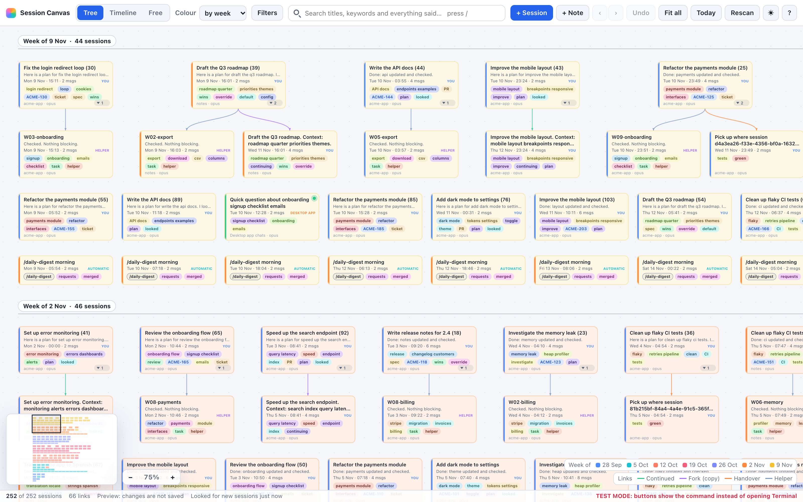

# Session Canvas

**Every Claude Code session on your Mac, on one board.**

Session Canvas reads the sessions Claude Code already saves on your Mac and lays them out as cards on an
infinite board. You can see which session continued, copied or started which, search everything that was
said, and reopen any session in your terminal with one click.



## What you get

- **One board, three views**: Tree (who started or continued whom), Timeline (day by day), Free (drag cards anywhere).
- **Links between sessions** found automatically: continued, copied (fork), handed over, started as a helper.
- **Search** everything said in every session, with small typos forgiven. Press `/`.
- **Reopen with one click**: Resume, Fork (a copy), New session in the same folder. A warning appears if that
  session is already open in another window, so two windows never write to the same conversation.
- **+ Session** starts a new session in your main folder, optionally with a quick-start command (for example the
  slash command you run every morning).
- **Sticky notes** you can send to a new or existing session as its next message.
- Rename, colour, hide, link, fold, undo. Everything you change is saved by itself.

## Install

Needs: a Mac, and [Claude Code](https://docs.claude.com/claude-code) installed. Nothing else: no Homebrew,
no pip, no Node. It uses the Python that comes with macOS (`/usr/bin/python3`).

1. Unzip `session-canvas-<version>.zip` anywhere (Downloads is fine).
2. In Terminal, go into that folder and run:

   ```sh
   ./install.sh
   ```

3. Answer two questions (add the command to your PATH? start at login?). Your browser opens the board.
4. A short **setup wizard** asks three things the first time: your main project folder, which terminal to use
   (Terminal, iTerm or Ghostty), and optional quick-start commands. Change them later under **?** → Settings.

The app goes to `~/.session-canvas/` and the `session-canvas` command to `~/.local/bin/`.
Running `./install.sh` again from a newer zip upgrades it and keeps your board.

The first time you open a session in Terminal or iTerm, macOS asks whether Session Canvas may control that
app. Click **OK** once. Ghostty needs no permission.

## Use

```sh
session-canvas            # start it (if needed) and open the board
session-canvas stop       # stop it
session-canvas status     # is it running?
session-canvas setup      # run the setup wizard again
session-canvas --dry-run  # test mode: buttons show the command instead of opening a window
```

The board lives at http://127.0.0.1:7788/ while it runs. Press **?** on the board for all shortcuts.

## Uninstall

```sh
session-canvas uninstall
```

It removes the app, the command and the login item, and asks before deleting your board data (notes,
positions, settings in `~/.session-canvas/data`). Your Claude Code sessions (`~/.claude`) are never touched.

## Privacy and safety

- **Everything stays on your Mac.** Nothing is sent to the internet; the page loads no outside resources.
- The server listens on **127.0.0.1 only**, so other computers can't reach it.
- Every action that changes something or opens a window needs a secret token that only the open page knows,
  and a same-origin check, so other websites can't press its buttons.
- Claude Code's sessions are **read-only** to Session Canvas. It only writes its own data folder.
- Notes you send to Claude are passed as a single argument from a file, never typed into a shell.

## Known limits

- **It reads Claude Code's internal files** (`~/.claude/projects/*/*.jsonl` for sessions,
  `~/.claude/sessions/*.json` to know which sessions are open right now). These are not a public format and can
  change in a new Claude Code version. Session Canvas skips anything it can't read instead of failing; if a
  Claude Code update changes the format, some cards or links may be missing until Session Canvas is updated.
- macOS only.
- Keep one board tab open: two tabs overwrite each other's changes.

## For developers

```sh
/usr/bin/python3 -m unittest discover -s app/tests -v      # unit, API and installer tests (made-up data only)
/usr/bin/python3 app/tests/browser_check.py                # drives the page in headless Google Chrome
./make-release.sh                                          # builds dist/session-canvas-<version>-<date>.zip
```

Python 3.9 standard library only, plain JavaScript, no build step.

## License

Proprietary. See [LICENSE](LICENSE).
